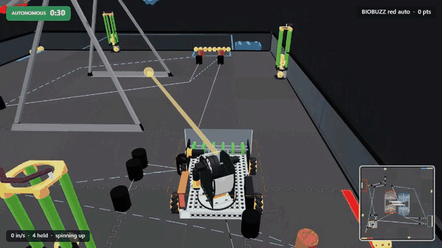
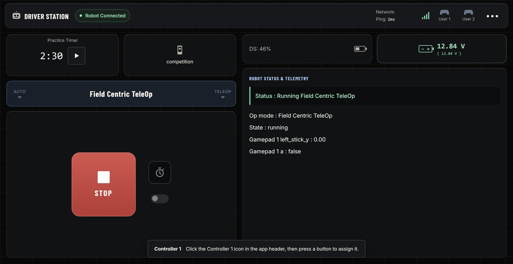
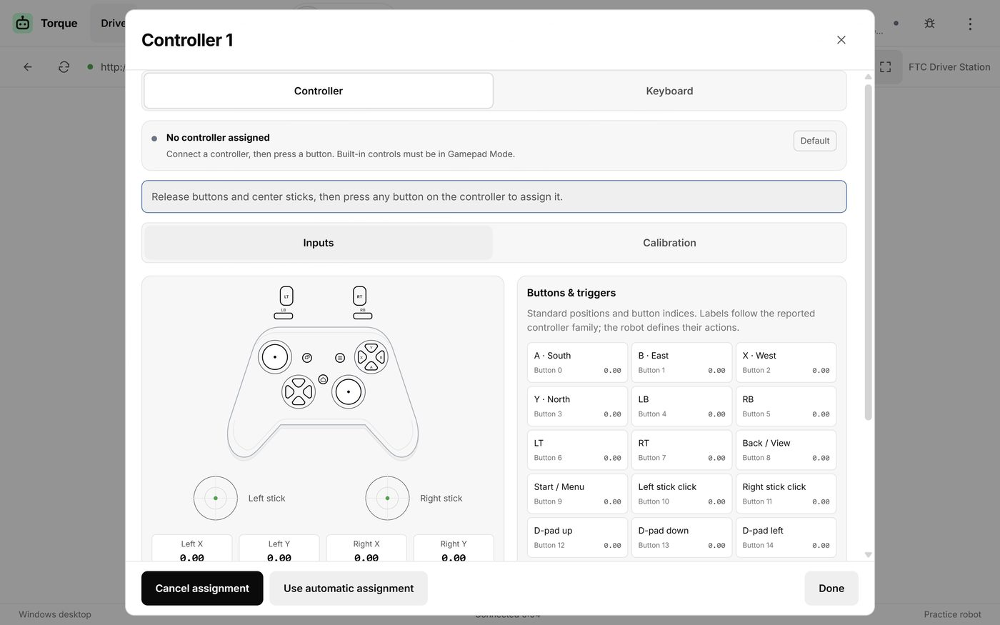
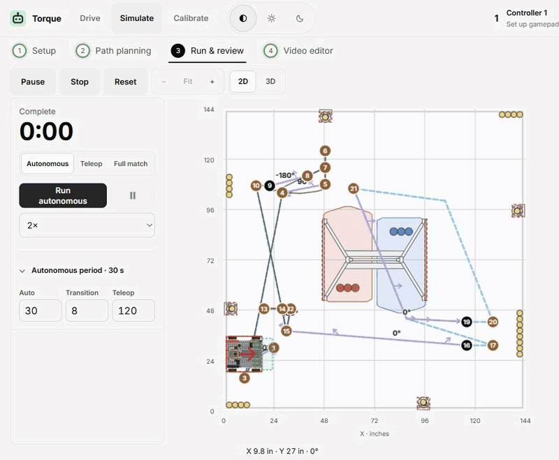
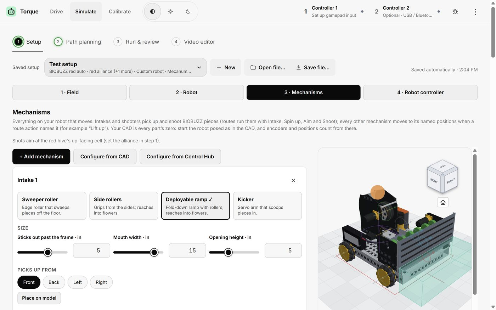
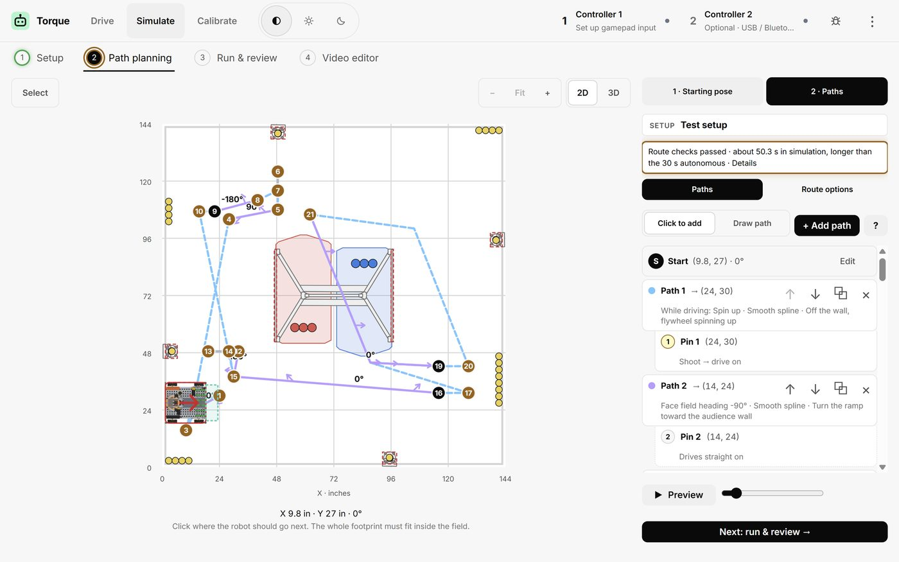
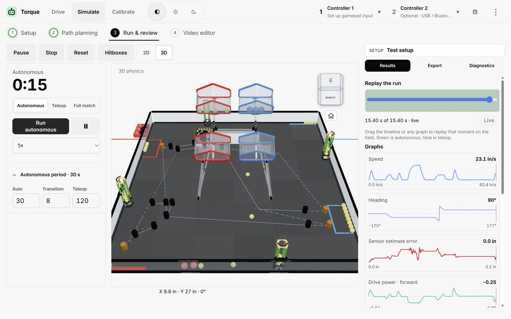
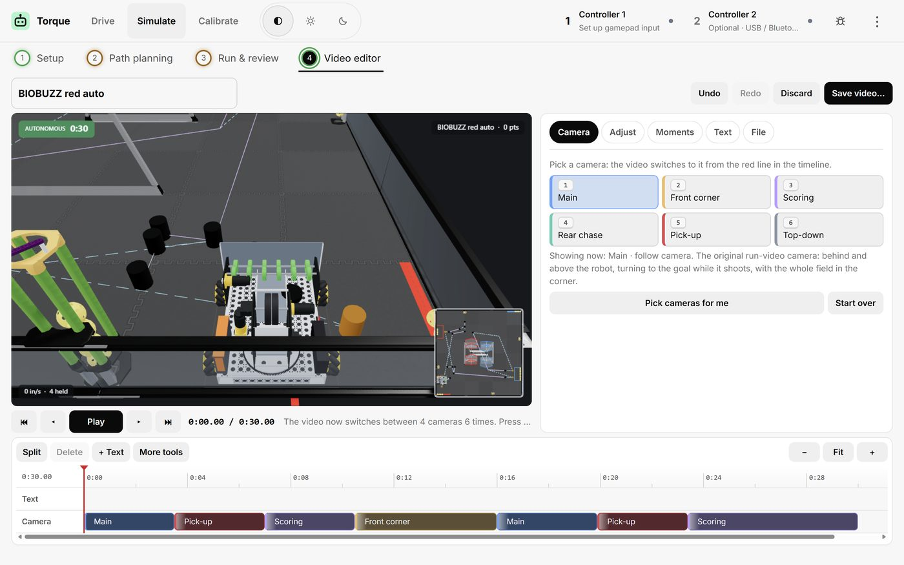
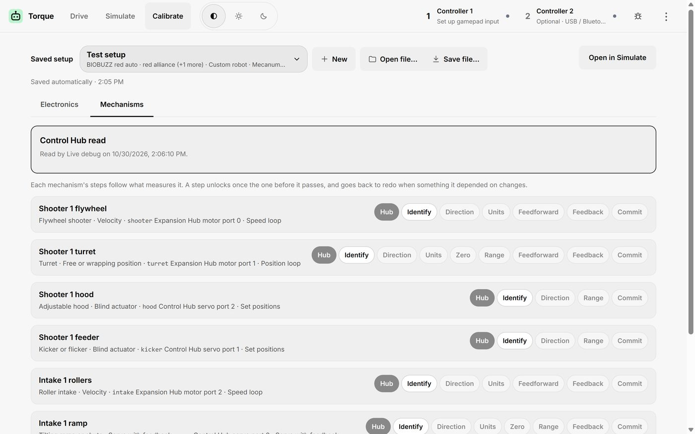
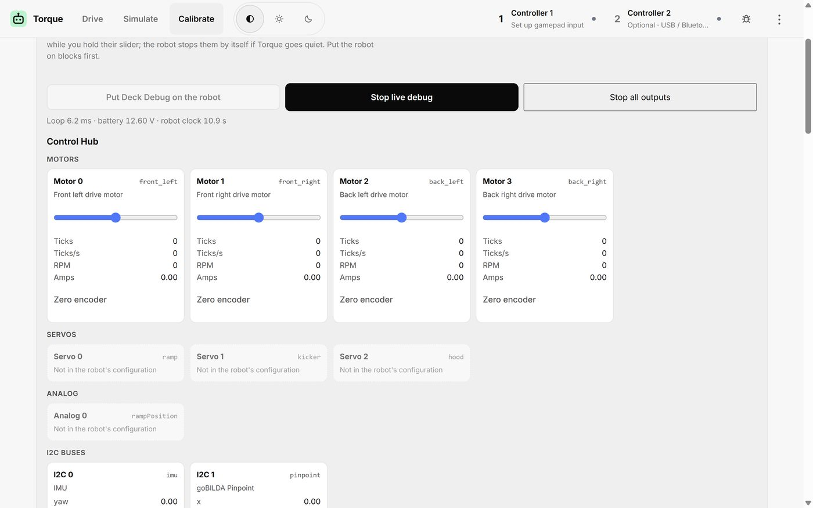

# Torque

**Drive, simulate and tune your robot, all in one app.** Made for FTC teams, and it works with any robot that has its own website.



[▶ Watch the full 30-second run](docs/media/robot-run-full.mp4)

## Install

**Windows:** open PowerShell, paste this and press Enter.

```powershell
irm https://raw.githubusercontent.com/AloeVeraZ/Torque-RobotController/main/install.ps1 | iex
```

That's it. Torque installs, adds a desktop icon and opens. You don't need an administrator account.

Prefer a normal download? Get it from the [releases page](https://github.com/AloeVeraZ/Torque-RobotController/releases/latest).

**Steam Deck and Linux:** download `DeckDriverStation-SteamDeck.run` from the [releases page](https://github.com/AloeVeraZ/Torque-RobotController/releases/latest) and run it.

**Apple Silicon Mac:** download `DeckDriverStation-macOS-arm64.zip` from the same page and open it.

## What it does

| | |
| --- | --- |
| **[Drive](#drive)** | Control your robot with a gamepad |
| **[Simulate](#simulate)** | Plan an autonomous and test it with no robot |
| **[Calibrate](#calibrate)** | Check your hardware and tune your mechanisms |

## Drive

Connect to your robot and drive it.



- **FTC robots:** a built-in Driver Station lets you pick an op mode, press INIT, START and STOP, read telemetry and use two gamepads. It works with a Control Hub or a Robot Controller phone, over Wi-Fi or USB.
- **Other robots:** ESP32, Raspberry Pi, MotionModule or anything with its own website. Torque opens the robot's own page and passes your gamepad through to it.
- **Saved robots:** save a robot once and reopen it with one tap. A saved FTC robot connects by itself when you join its Wi-Fi.
- **Gamepads:** Xbox, PlayStation, Nintendo, Logitech and Steam Deck controls. A live test screen shows every stick and button, and measures stick drift.
- **Touch friendly:** every screen works by touch, with an optional on-screen keyboard.

**To connect:** open **⋮ → Settings**, join the robot's Wi-Fi, enter its address and press **Open robot**.



## Simulate

Build your robot, draw a route and watch it run in full physics. No robot, no extra downloads and no internet needed.



1. **Set up your robot.** Choose its size, drivetrain, motors, sensors and mechanisms such as intakes, shooters and turrets. You can also import your own CAD.

   

2. **Plan a route.** Click to add stops or draw the path. Torque keeps the whole robot clear of obstacles.

   

3. **Run it.** Replay the run on a timeline, graph its speed and heading, and see how many pieces it picked up, shot and scored.

   

4. **Make a video.** Film the run with follow, scoring and top-down cameras. Then cut it, add text and save an MP4.

   

5. **Send it to your robot.** Export working code, or upload it to your Control Hub over Wi-Fi. A guided check then tests each motor and sensor on the real robot.

**Exports to:** Control Hub OnBot Java, TeamCode, Pedro Pathing 3 and MotionModule.

**Fields:** BIOBUZZ, or a custom field with your own obstacles.

**Prefer a terminal?** The `deck-sim` command plans, runs, optimizes and exports routes too.

[Full simulator guide](docs/SIMULATION.md)

## Calibrate

Tune your robot step by step using real readings from your Control Hub.



- **Live debug:** see every motor, servo and sensor your Control Hub reports, and what's plugged into each port.
- **Set up from the hub:** one button maps your devices into your robot setup.
- **Guided tuning:** Torque checks each mechanism in order: direction, units, zero, range, then control. Each step has to pass before the next one starts, so a bad reading can't throw off later steps.
- **Keep the results:** get your tuned values as a ready-to-use Java file.
- **Program Axon servos:** the Axon Programmer tab sets V1 and V2 Axon servos to servo or continuous rotation mode and changes their settings, through Axon's V2 programmer. [Guide](docs/AXON.md)



[Full calibration guide](docs/CALIBRATION.md) · [FTC rules and Competition mode](docs/COMPETITION-RULES.md)

## Updating

Open **⋮ → Updates → Check for updates**. Your saved robots and settings are kept.

You can also switch to the **Testing** channel there to try new features early.

## Good to know

- **Torque is not a safety system.** It can't act as a hardware emergency stop, so keep your robot's own stop controls ready.
- **Not for competition.** The Driver Station is an independent build and isn't certified for FTC competition. It isn't made by REV or FIRST.
- **Your robot stays private.** Nothing is hosted in the cloud, and robot passwords aren't saved with your robot addresses.

## More help

- [Quick start](docs/QUICKSTART.md)
- [FTC robots](docs/FTC.md)
- [Controllers](docs/CONTROLLERS.md)
- [Touch controls](docs/TOUCH.md)
- [Programming Axon servos](docs/AXON.md)
- [Website compatibility](docs/COMPATIBILITY.md)
- [Updates](docs/UPDATES.md)
- [Development and how it works](docs/DEVELOPMENT.md)

## License

Torque's own code is [MIT licensed](LICENSE). It builds on Electron, Pedro Pathing, DSIM, Rapier, three.js, OpenJDK and more; see the [credits and third-party notices](THIRD-PARTY-NOTICES.md).

The simulator's physics come from [DSIM](https://github.com/genius0412/dsim) by Dohun Kim, which is licensed for noncommercial use only. That makes complete releases free for noncommercial use, such as team practice.

Not affiliated with or endorsed by FIRST®, REV Robotics, Valve or any project above.
